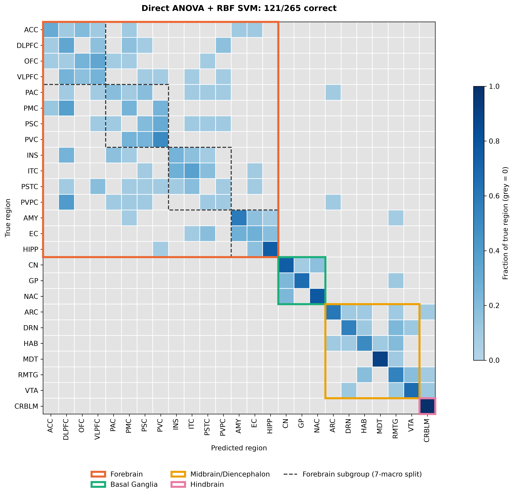
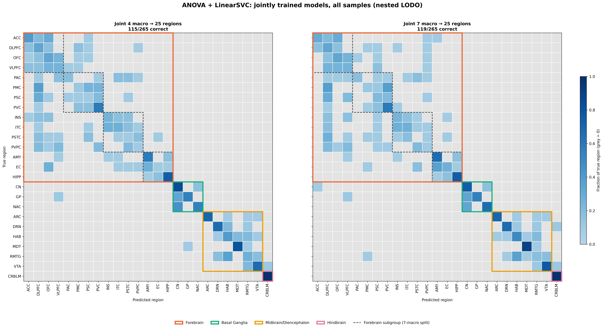

# Brain region classification from RNA expression

This project predicts the anatomical source of adult human brain RNA expression samples. It compares direct prediction of 25 regions, prediction of 4 or 7 broader regions, and two-stage 25-region classifiers. Evaluation holds out one donor at a time, so samples from the same donor do not appear in both training and test sets.

## Data

The input `GSE211792_logCPM_cent.csv` has **33,279 genes × 265 samples** from **6 donors**, **25 anatomical regions**, and two RNA fractions (**N**, neuronal; **G**, non-neuronal). Each column is one donor–region–fraction sample; each row is a gene. The values are centered log counts per million (log-CPM), which summarize RNA abundance, rather than DNA sequence or a percentage of cells. Region labels come from the sample names and are the prediction targets. The source series is [GSE211792](https://www.ncbi.nlm.nih.gov/geo/query/acc.cgi?acc=GSE211792).

The input is included as `GSE211792_logCPM_cent.csv.gz`, a losslessly compressed copy of the 155 MiB CSV. Pandas reads it directly; no extraction is needed. You can set `BRAIN_REGION_DATA_FILE` to a different `.csv` or `.csv.gz` file. Saved results and experiment checkpoints are included as well.

## Results at a glance

| Task | Best tested method | Mean macro F1 ± SD across six held-out donors |
| --- | --- | ---: |
| 4 macro regions | MI + RBF SVM | 1.000 ± 0.000 |
| 7 macro regions | MI + RBF SVM | 0.848 ± 0.109 |
| Direct 25 regions | ANOVA + RBF SVM | 0.420 ± 0.139 |

These rows come from `results/full_grid_summary.csv`. The number of classes differs between tasks, so the scores are not directly comparable as measures of the same difficulty. See `results/joint_feature_comparison/` for joint two-stage experiments; those fixed-setting comparisons should be read separately from nested-tuned results.

### Main figures

**Held-out donor performance.** Macro F1 distributions across the tested feature methods, kernels, and model families. [Open full-size figure](results/full_grid_boxplot_all_models.png).


**Direct 25-region classification.** Confusion matrix for the best tested direct classifier (ANOVA + RBF SVM). [Open full-size figure](results/rbf_anova_25_regions_nested/confusion_matrix_25.png).



**Joint two-stage models.** Held-out 25-region confusion matrices for the joint 4→25 and 7→25 ANOVA models. [Open full-size figure](results/joint_4_vs_7_confusion_25.png).



## Set up and run

```bash
git clone -b codex/portable-notebooks-results https://github.com/chanyu867/mRNA-Seq-brain-region-classification.git
cd mRNA-Seq-brain-region-classification
python3 -m venv .venv
source .venv/bin/activate
python -m pip install -r requirements.txt

# Optional: use a different input file:
export BRAIN_REGION_DATA_FILE=/path/to/GSE211792_logCPM_cent.csv

jupyter lab
```

Open `ML_Project_analysis.ipynb` and run its cells in order, then open `ML_Project_plotting.ipynb`. Both notebooks define `PROJECT_DIR`, `DATA_FILE`, `RESULTS_DIR`, and `RESUME_CHECKPOINT_DIR` in their first code cell. The default input is the bundled compressed CSV. Set the environment variable before launching Jupyter if you want to use another input file.

The analysis notebook uses saved summaries when present, including the nested model grid. It checks and displays saved tables without rerunning that expensive grid. To **recompute or resume the full nested grid**, remove `results/full_grid_summary.csv` and run the analysis notebook; it reuses available files in `resume_checkpoints/`. A fresh run can take many hours. Other experiment functions reuse their own saved fold files when present. For a complete clean rerun, move the existing `results/` and `resume_checkpoints/` directories aside first.

## Files

| File | Purpose |
| --- | --- |
| `ML_Project_analysis.ipynb` | Set paths, run or reuse experiments, inspect summary tables, check saved outputs. |
| `ML_Project_plotting.ipynb` | Regenerate PCA views, donor-wise performance plots, and confusion matrices from data and saved predictions. |
| `project_analysis.py` | Nested donor-held-out experiments, PCA variance search, and result aggregation. |
| `joint_feature_comparison.py` | Shared-loss hierarchical models with ANOVA, mutual information, or PCA features and linear or RBF kernels. |
| `cell_type_comparison.py` | Neuronal-only and non-neuronal-only experiments and family comparisons. |
| `project_plots.py` | Figure generation from saved predictions and the input CSV. |
| `GSE211792_logCPM_cent.csv.gz` | Losslessly compressed gene-expression matrix; pandas reads it directly. |
| `results/` | Saved fold predictions, score summaries, figures, and selected model artifacts. |
| `resume_checkpoints/` | Donor-level experiment checkpoints and cached feature scores for resuming runs. |
| `resume_saved_results/` | Preserved result files used by the resume workflow. |
| `requirements.txt` | Python dependencies. |

Feature selection and scaling for predictive models are fitted within training folds. The PCA scatter plots are descriptive and use all samples. Some preserved results from an earlier joint ANOVA experiment have held-out predictions but no original training source; those figures can be reproduced from the saved predictions, while that exact older fit cannot be rebuilt from this code.
